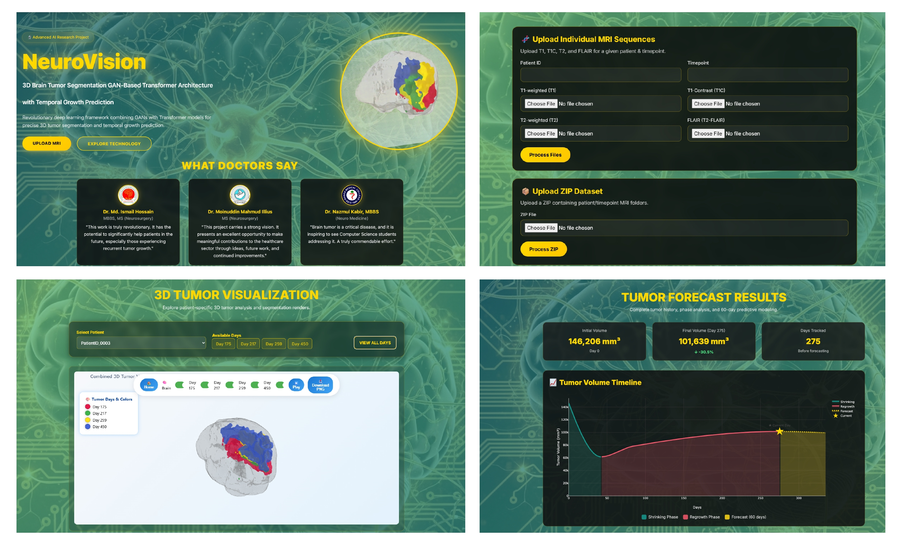

# NeuroVision: 3D Brain Tumor Segmentation & Temporal Growth Forecasting

NeuroVision is an end-to-end deep learning web platform designed for automated multimodal 3D brain tumor segmentation, interactive 3D WebGL visualization, and longitudinal tumor volume forecasting. Built with Flask, PyTorch, MONAI, and Plotly, the system streamlines post-treatment glioma monitoring by converting raw 3D MRI scans into quantitative volumetric trajectories and interactive 3D anatomical models.

## Web Application Preview



*Overview of the NeuroVision platform: Home Dashboard (top-left), Multimodal MRI & ZIP Dataset Upload (top-right), Interactive 3D Tumor Visualization (bottom-left), and 60-Day Tumor Forecast Results (bottom-right).*

---

## Table of Contents

 1. [Overview & Clinical Motivation](#overview--clinical-motivation)

 2. [Key Features](#key-features)

 3. [System Workflow](#system-workflow)

 4. [Dataset Availability & Sample Structure](#dataset-availability--sample-structure)

 5. [Model Architecture & Research Overview](#model-architecture--research-overview)

 6. [Project Structure](#project-structure)

 7. [Prerequisites & Installation](#prerequisites--installation)

 8. [Model Weights Setup](#model-weights-setup)

 9. [Running the Application](#running-the-application)

10. [Usage Guide](#usage-guide)

11. [API Endpoints Reference](#api-endpoints-reference)

12. [Authors & Supervision](#authors--supervision)

## Overview & Clinical Motivation

Gliomas are aggressive primary brain tumors that require continuous longitudinal monitoring to evaluate treatment response and detect early recurrence. Traditional clinical workflows rely on manual 2D slice-by-slice inspection, which is time-consuming, prone to inter-observer variability, and makes it difficult to perceive true 3D tumor morphology or predict future progression.

NeuroVision addresses these challenges within a single unified web interface:

* **Automates 3D Segmentation:** Extracts tumor boundaries across four standard MRI modalities (`T1`, `T1ce`, `T2`, and `FLAIR`).

* **Quantifies Volumetric Progression:** Computes physical tumor volume in cubic millimeters ($\text{mm}^3$) from voxel dimensions across irregular clinical follow-up visits.

* **Forecasts Future Growth:** Interpolates longitudinal volume history and predicts 60-day tumor growth trajectories with uncertainty bounds.

* **Visualizes in 3D:** Generates browser-based 3D surface meshes of both the brain envelope and tumor volume for single-day inspection and multi-day comparison.

## Key Features

* **Multimodal 3D MRI Processing:** Supports NIfTI files (`.nii` and `.nii.gz`) across `T1n` (T1-weighted), `T1c` (T1-contrast enhanced), `T2w` (T2-weighted), and `T2f` (FLAIR) sequences, automatically reorienting volumes to canonical RAS space and applying Z-score normalization.

* **Dual Upload Modes:**

  * *Single Timepoint Upload:* Upload the four MRI sequences for a specific patient and clinical day.

  * *Batch ZIP Dataset Upload:* Upload a structured ZIP archive containing multiple patients and follow-up timepoints for automated batch segmentation and visualization generation.

* **Interactive 3D WebGL Rendering:** Uses the Marching Cubes algorithm (`scikit-image`) and Plotly `Mesh3d` to build standalone interactive HTML visualizations with toggleable brain/tumor layers, day-by-day color coding, time-lapse animation playback, and PNG export.

* **60-Day Quantile Growth Forecasting:** Uses Piecewise Cubic Hermite Interpolating Polynomial (PCHIP) interpolation to convert irregular follow-up dates into continuous daily time series, followed by autoregressive 60-day forecasting with median (`P50`) and 80% confidence interval (`P10`–`P90`) predictions.

* **Automated Phase Detection & Clinical Summary:** Automatically identifies shrinking, regrowth, or stable tumor phases and presents a visual timeline alongside statistical summaries.

## System Workflow

```
[Multimodal MRI Input (.nii / .nii.gz or .zip)]
                     │
                     ▼
[Preprocessing: RAS Reorientation -> Z-Score Norm -> Center Crop/Pad]
                     │
                     ▼
[3D Segmentation Inference (MONAI SegResNet)]
        │                                │
        ▼                                ▼
[3D Mesh Reconstruction]        [Voxel Volume Calculation (mm³)]
(Marching Cubes + Plotly)       (tumor_volumes_unseen.csv)
        │                                │
        ▼                                ▼
[Interactive 3D HTML Scenes]    [PCHIP Daily Interpolation]
(Single-Day & Multi-Day)        (interpolated_data.csv)
                                         │
                                         ▼
                                [60-Day Growth Forecast]
                                (TransformerQuantileDelta)
                                         │
                                         ▼
                                [Interactive Forecast Dashboard]
```

## Dataset Availability & Sample Structure

**Research Notice:** The curated longitudinal MRI dataset and experimental data splits used in this project are currently **not publicly disclosed** because this work is part of ongoing academic research under preparation for journal publication. Full dataset details and access instructions will be published in this repository once the corresponding manuscript is officially published in a peer-reviewed journal.

To test the web application with your own NIfTI scans or ZIP archives, organize patient data using the following directory structure:

```text
Dataset_Sample/
├── PatientID_0001/
│   ├── Day 00/
│   │   ├── t1n.nii.gz
│   │   ├── tc1.nii.gz
│   │   ├── t2w.nii.gz
│   │   └── t2f.nii.gz
│   └── Day 90/
│       ├── t1n.nii.gz
│       ├── tc1.nii.gz
│       ├── t2w.nii.gz
│       └── t2f.nii.gz
└── PatientID_0002/
    └── Day 00/
        ├── t1n.nii.gz
        ├── tc1.nii.gz
        ├── t2w.nii.gz
        └── t2f.nii.gz
```

* **`t1n`:** T1-weighted native scan
* **`tc1`:** T1-weighted contrast-enhanced scan
* **`t2w`:** T2-weighted scan
* **`t2f`:** T2-FLAIR scan

## Model Architecture & Research Overview

This project was developed as a Capstone Senior Design Project at North South University. The research framework and deployed web modules encompass:

### 1. 3D Tumor Segmentation

* **Research Architecture:** Proposed **GAN-CF-SwinRA-UNet3D** (Two-Stage Coarse-to-Fine 3D Swin-Transformer Residual Attention U-Net with adversarial learning), evaluated with Grad-CAM++ and LIME explainability.

* **Web Deployment Backbone:** Integrated with MONAI `SegResNet` (`in_channels=4`, `out_channels=1`, input resolution `160 x 160 x 96`) for fast clinical inference and native NIfTI mask/overlay export.

* **Validation Performance:** Achieved strong internal and external generalization (internal Dice = `0.8885`, IoU = `0.8259`; external validation Dice = `0.8032`, IoU = `0.6928`).

### 2. Temporal Tumor Growth Forecasting

* **Research Architecture:** Weighted soft-voting ensemble combining a **Modified Vanilla Transformer**, **Bidirectional LSTM (Bi-LSTM)**, and **Temporal Fusion Transformer (TFT)**, achieving a test Mean Absolute Error (MAE) of `84.60 mm³`.

* **Web Deployment Backbone:** Deployed using `TransformerQuantileDelta` (`d_model=96`, `nhead=4`, `num_layers=3`, `SEQUENCE_LEN=10`, `HORIZON_DAYS=60`), predicting log-delta volumetric changes across `0.1`, `0.5`, and `0.9` quantiles.

## Project Structure

```
NeuroVision/
├── app.py                          # Main Flask application, preprocessing, inference & API routes
├── visualization_generator.py      # Marching Cubes 3D mesh & Plotly HTML visualization builders
├── requirements.txt                # Python package dependencies
├── .gitignore                      # Excludes virtual environments, weights, and patient MRI data
├── models/                         # Pretrained model weights and scaler artifacts (not tracked in Git)
│   ├── best_model_SegResNet.pt
│   ├── best_transformer_delta_log.pt
│   └── scalers_artifacts.npz
├── outputs/                        # Temporary NIfTI processing outputs
├── results/                        # Generated volume tables and forecast plots
│   ├── graphs/                     # Exported PNG forecast charts
│   ├── interpolated_data.csv       # PCHIP-interpolated daily tumor volumes
│   └── tumor_volumes_unseen.csv    # Raw segmented tumor volumes per patient/day
├── static/
│   └── img/                        # UI graphics, logos, and team assets
├── templates/                      # Jinja2 HTML frontend templates
│   ├── about.html                  # Team, supervisor, and project overview page
│   ├── base.html                   # Shared layout, animated theme, and navigation bar
│   ├── dashboard.html              # Landing page and project introduction
│   ├── forecast.html               # Patient selector for tumor growth forecasting
│   ├── forecast_visualization.html # Interactive Plotly forecast timeline and phase summary
│   ├── index.html                  # Single-timepoint and ZIP dataset upload interface
│   ├── timepoints.html             # Processed patient timepoints and NIfTI download table
│   └── visualization.html          # Interactive 3D tumor viewer page
└── uploads/                        # Patient scan directories and generated 3D HTML files
```

## Prerequisites & Installation

### Prerequisites

* Python 3.10 or higher

* `pip` package manager

* Optional: NVIDIA GPU with CUDA support for accelerated 3D inference (runs on CPU automatically if CUDA is unavailable)

### Installation Steps

1. **Clone the repository:**

   ```bash
   git clone https://github.com/alaminpiyal2002/NeuroVision.git
   cd NeuroVision
   ```

2. **Create and activate a virtual environment:**

   * **Windows:**

     ```bash
     python -m venv venv
     venv\Scripts\activate
     ```

   * **macOS / Linux:**

     ```bash
     python3 -m venv venv
     source venv/bin/activate
     ```

3. **Install required Python packages:**

   ```bash
   pip install -r requirements.txt
   ```

## Model Weights Setup

Because deep learning model checkpoints exceed standard Git file size limits, `.pt` and `.npz` files are excluded from version control via `.gitignore`. Before starting the server, place the pretrained artifacts in the following locations:

| File | Required Location | Purpose | 
| ----- | ----- | ----- | 
| `best_model_SegResNet.pt` | Root directory (`./best_model_SegResNet.pt`) | 3D multimodal MRI tumor segmentation weights | 
| `best_transformer_delta_log.pt` | `models/best_transformer_delta_log.pt` | 60-day quantile tumor growth forecasting weights | 
| `scalers_artifacts.npz` | `models/scalers_artifacts.npz` | MinMax scaler parameters and clipping quantiles | 

*(If you host these weights on GitHub Releases or Google Drive, download and copy them into the paths above before running `app.py`.)*

## Running the Application

1. Ensure your virtual environment is activated and model weights are in place.

2. Start the Flask development server:

   ```bash
   python app.py
   ```

3. Open your web browser and navigate to:

   ```text
   http://127.0.0.1:5000
   ```

## Usage Guide

1. **Upload MRI Scans (`/upload_page`):**

   * **Individual Scan:** Enter a `Patient ID` (e.g., `PatientID_0001`) and `Timepoint` (e.g., `Day 90`), select the four NIfTI files (`t1n`, `tc1`, `t2w`, `t2f`), and click **Process Files**.

   * **ZIP Archive:** Upload a `.zip` file matching the structure shown in [Dataset Availability & Sample Structure](#dataset-availability--sample-structure) and click **Process ZIP**.

   * The backend automatically segments the tumor, saves `pred_mask.nii` and `overlaid.nii`, generates 3D HTML scenes, and updates the longitudinal volume CSVs.

2. **Inspect 3D Visualizations (`/view_visualization`):**

   * Select a patient from the dropdown menu.

   * Click any **Day** button to inspect the single-timepoint 3D brain and tumor mesh, or click **View All Days** to compare color-coded tumor progression across all timepoints with play/pause animation.

3. **Forecast Tumor Growth (`/forecast_page`):**

   * Select a patient with longitudinal volume history (requires at least 10 interpolated daily points).

   * Click **View Forecast** to open the interactive 60-day volume trajectory, phase breakdown (shrinking vs. regrowth), and statistical summary.

## API Endpoints Reference

| Route | Method | Description | 
| ----- | ----- | ----- | 
| `/` | `GET` | Renders the main landing page and dashboard overview. | 
| `/upload_page` | `GET` | Renders the MRI individual and ZIP dataset upload page. | 
| `/upload_files` | `POST` | Processes 4 uploaded NIfTI modalities (`t1n`, `tc1`, `t2w`, `t2f`) for one timepoint. | 
| `/upload_zip` | `POST` | Extracts and batch-processes multi-patient, multi-timepoint ZIP archives. | 
| `/view_timepoints` | `GET` | Lists all processed patients, timepoints, and downloadable NIfTI outputs. | 
| `/view_visualization` | `GET` | Renders the interactive 3D visualization selection interface. | 
| `/view_visualization/<patient>/<day>` | `GET` | Serves the standalone 3D HTML scene for a specific day or `combined` view. | 
| `/forecast_page` | `GET` | Renders the patient selection interface for growth forecasting. | 
| `/forecast_visualization/<patient>` | `GET` | Computes and displays the interactive 60-day forecast report. | 
| `/forecast` | `POST` | Generates and returns the path to a static Matplotlib forecast PNG chart. | 
| `/download/<patient>/<timepoint>/<file>` | `GET` | Downloads `pred_mask.nii` or `overlaid.nii` for a given scan. | 
| `/force_forecast_data` | `GET` | Recomputes all tumor volumes and PCHIP-interpolated CSVs from `uploads/`. | 
| `/about` | `GET` | Renders team members, faculty advisor, and project overview details. | 

## Authors & Supervision

**Department of Electrical and Computer Engineering, North South University (Fall 2025)**

* **Md. Abu Yousuf Neshad**

* **Md Al Amin**

* **Irfan Shah Mayeen**

* **Mst. Magferat Khatun**

**Faculty Advisor:**

* **Dr. Sifat Momen**, Professor, Department of Electrical and Computer Engineering, North South University

## Disclaimer

*NeuroVision is an academic research prototype developed for educational and research purposes. It is not a certified medical device and should not be used as a standalone clinical diagnostic tool.*